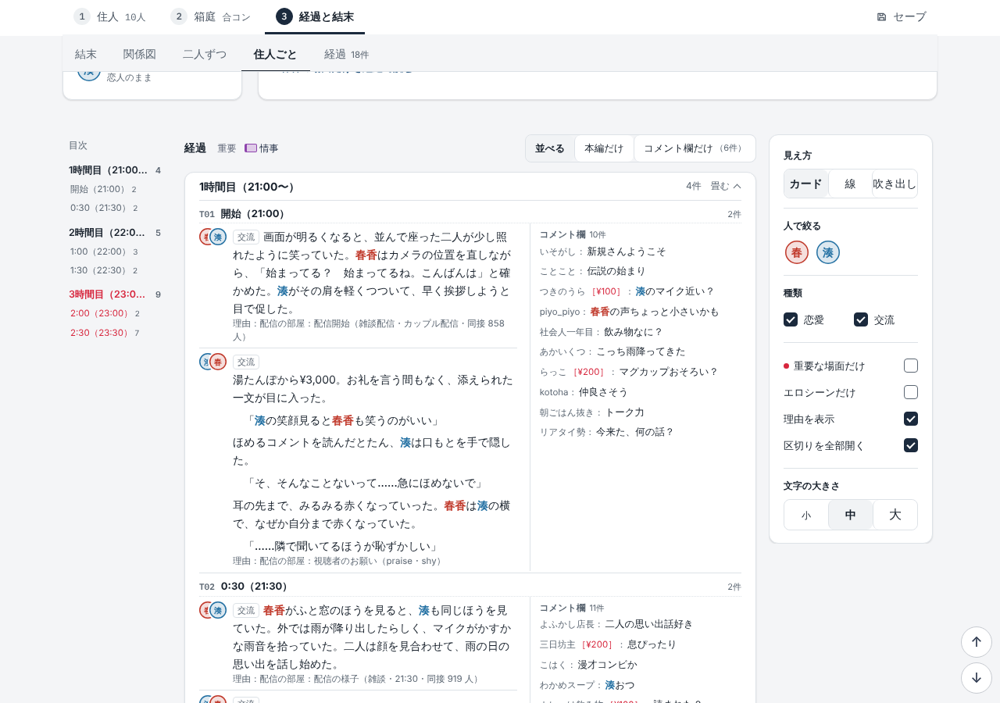
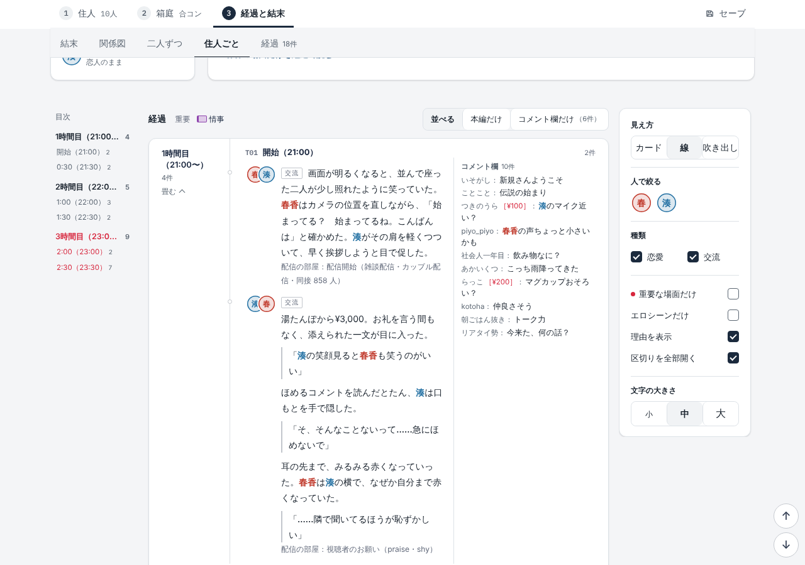
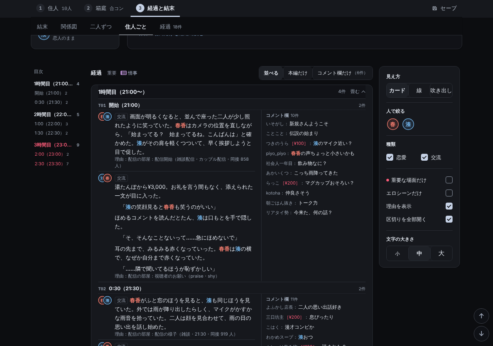
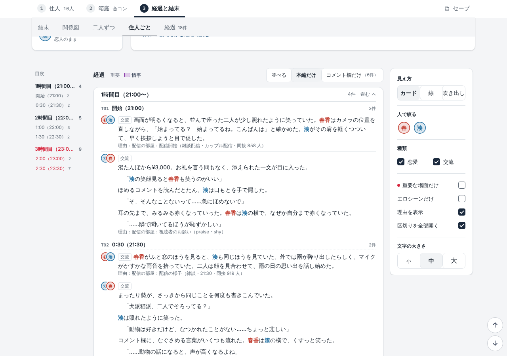
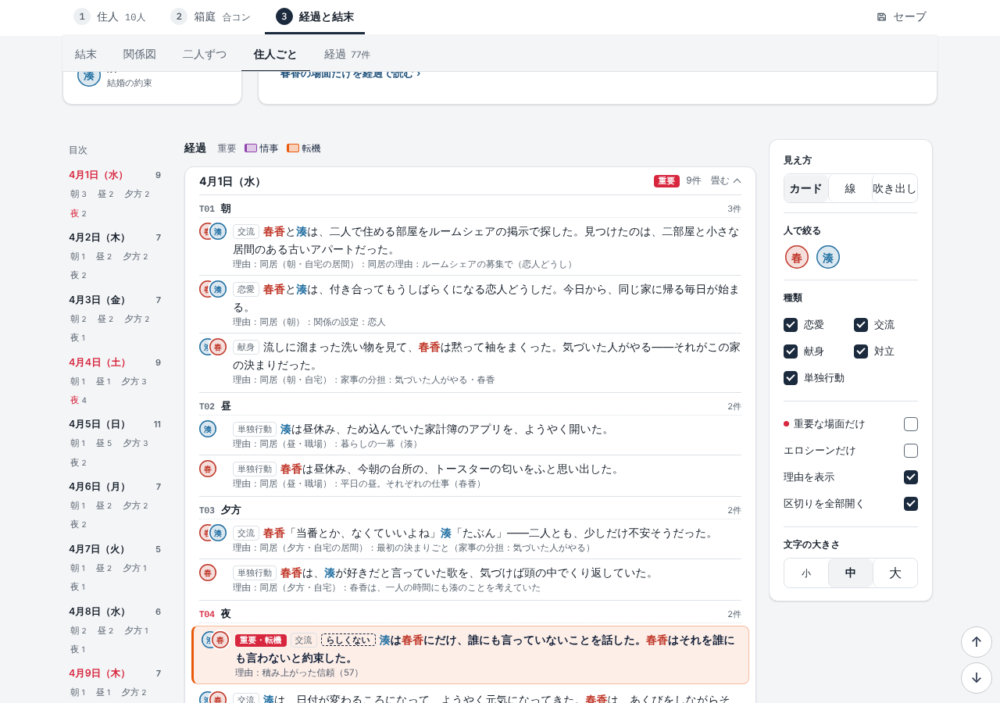
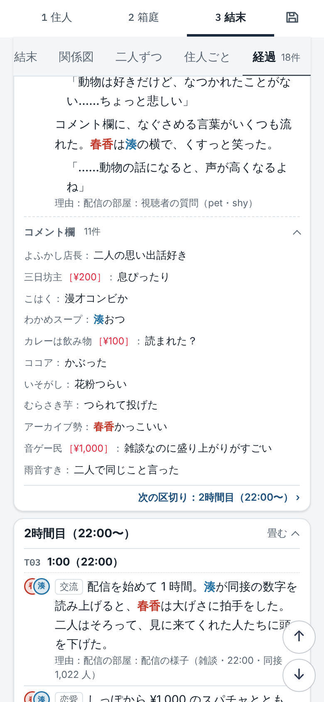
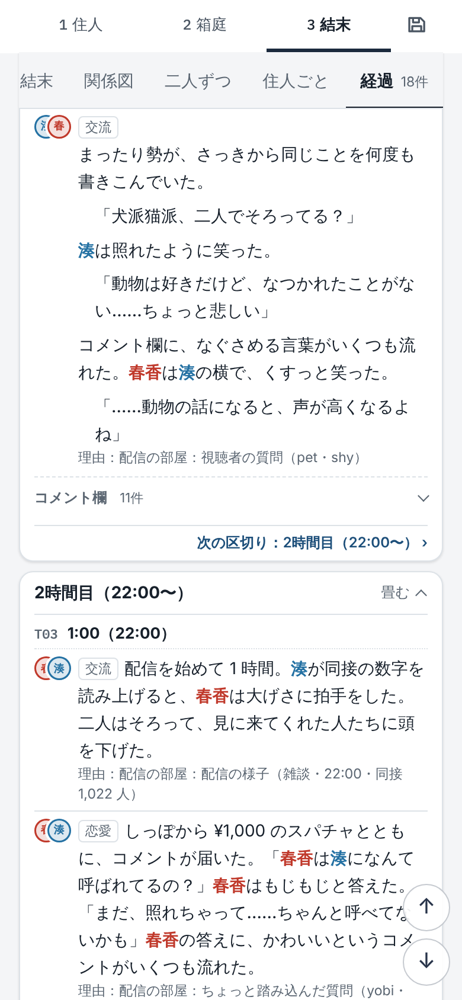
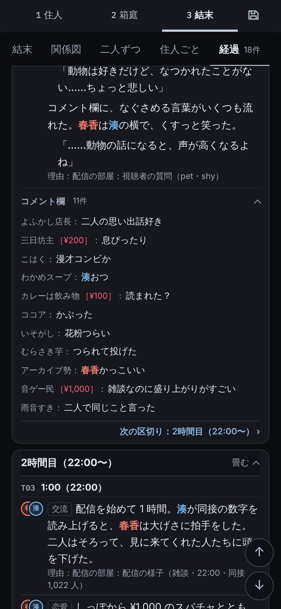
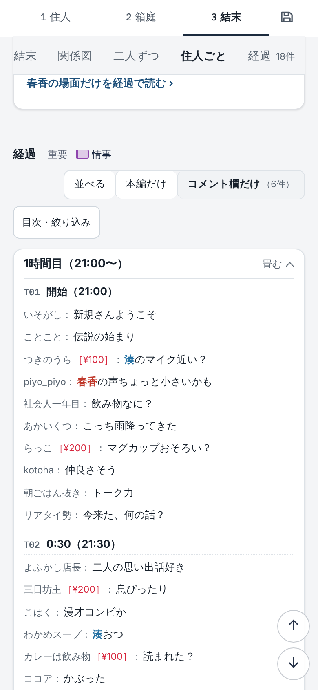
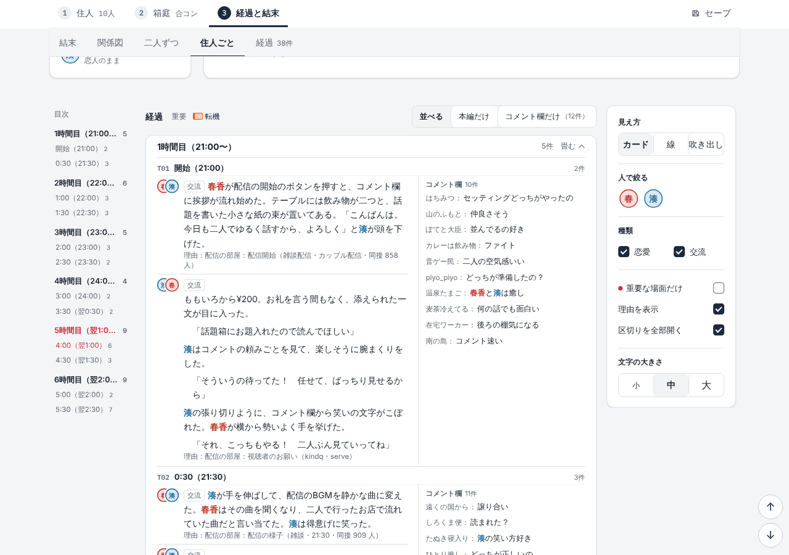

# 経過の本編とコメント欄を並べる（2026-11-06）の確かめ

利用者の指示「コメント欄と本文欄が今はタブを切り替えないと表示できなくて読みづらい。同時に見られるようにしてほしい。」への直し。仕組みは `log-channel-design.md` の 5 章、PC とスマホの機能の表は `../2026-11-04/mobile-parity.md`（結果タブ）。

## 見え方

- 経過の見出しの横の切り替えを「並べる（既定）｜本編だけ｜コメント欄だけ（n件）」の 3 択にした。選んだ見え方はブラウザに残る（`hakoniwa:rv` の `chv`）。コメント欄（`e.ch`）の無い結果は切り替えも格子も出ず、今のまま。
- PC（幅 1280）：区切りごとに 左 本編・右 コメント欄（3：2）。区切りの見出しは左右をまたぎ、同じ区切りの本編とコメントが同じ高さから始まる。コメントの列は細い縦線で分け、字は小さめ・名前を薄く・詰めた行間。
- スマホ（幅 390・isMobile）：1 列。各区切りの本編の下に、その区切りのコメント欄（頭「コメント欄 n件」を押すと畳む／開く、既定は開く）。経過の見出しの右の「コメントを全部畳む／全部開く」で全部を閉じる／開く。横のはみ出し無し。
- 絞り込み（人・種類・重要な場面だけ・エロシーンだけ）は本編に効き、本編が残った区切りのコメントはそのまま並ぶ（コメントだけの区切りは絞り込み中は出さない）。「経過 n件」・区切りの件数・目次の件数は本編だけ（今のまま）。
- テキストの書き出し・PDF は今のまま本編のあとにコメント欄（PDF は印刷の間だけ本編に戻すので、並べた見た目は持ち込まない）。保存・履歴・共有カードは変わらない（記録を変えない）。

## Playwright（幅 1280 と 390（isMobile・hasTouch）、R18版と全年齢版）

パックの試しのフォルダ（`pack-site.js hakoniwa-packs/set-b --codes=hakoniwa-packs/codes.example.json`、コード DDDD-EEEE-FFFF）で、配信の部屋（set-b-haishin。配信時間 6 時間・リスナー 1,000 人、二人）と同居生活（futari。コメント欄なし）を `HK.simulate` → `HK.UIres.show` で開き、経過を見た（区切りを全部開く）。R18版・全年齢版とも 48 項目すべて合格。

### R18版

- ○ [full pc] 配信の記録：記録 30件・コメント欄 6件
- ○ [full pc] 3 択：並べる*|本編だけ|コメント欄だけ（6件）（既定は並べる）
- ○ [full pc] 並べる：コメントの行 6件（すべて）・本編の行 18件・区切り 6
- ○ [full pc] 横のはみ出し 0px
- ○ [full pc] 同じ区切りの本編とコメントが同じ高さから始まる（6 区切り）
- ○ [full pc] 列の幅 本編 407px：コメント欄 271px
- ○ [full pc] 全部畳むボタンは出ない（PC は畳まない）
- ○ [full pc] ページの例外 0件 
- ○ [full pc] 人で絞る（春香）：本編 17件・残った区切りのコメント 6件（コメントだけの区切りは出さない）
- ○ [full pc] 重要な場面だけ：本編 3件・コメント 2件
- ○ [full pc] エロシーンだけ：本編 3件・コメント 2件
- ○ [full pc] 「経過」の件数は見え方で変わらない：経過18件
- ○ [full pc] 本編だけ：コメント 0・並べる格子 0・覚えた値 main
- ○ [full pc] コメント欄だけ：コメント 6件・本編 0・覚えた値 cm
- ○ [full pc] 開き直しても覚えた見え方（コメント欄だけ）
- ○ [full pc] 並べるに戻す（覚えた値 side）
- ○ [full pc] テキストの書き出し：本編のあとに「■ コメント欄」（本編にコメント無し）
- ○ [full pc] PDF（印刷の間）：経過は本編だけ・後ろにコメント欄 6件・印刷のあとで並べるに戻る
- ○ [full pc] 見え方「line」でも並べる（コメント 6件・はみ出し 0px）
- ○ [full pc] 見え方「bubble」でも並べる（コメント 6件・はみ出し 0px）
- ○ [full pc] ダーク：区切りの地 rgb(22, 24, 29)・名前 rgb(154, 164, 179)・本文 rgb(227, 232, 240)
- ○ [full pc] 同居生活：切り替え無し・並べる格子無し（本編 77件）・はみ出し 0px
- ○ [full pc] ページの例外（最後まで） 0件 
- ○ [full sp] 配信の記録：記録 30件・コメント欄 6件
- ○ [full sp] 3 択：並べる*|本編だけ|コメント欄だけ（6件）（既定は並べる）
- ○ [full sp] 並べる：コメントの行 6件（すべて）・本編の行 18件・区切り 6
- ○ [full sp] 横のはみ出し 0px
- ○ [full sp] 各区切りのコメント欄が本編の下（6 区切り）
- ○ [full sp] 経過の見出しの右に「コメントを全部畳む」
- ○ [full sp] ページの例外 0件 
- ○ [full sp] 全部畳む → コメント欄が全部閉じる（見えるコメント 0件）
- ○ [full sp] 区切りの「コメント欄」を押す → その区切りだけ開く（見えるコメント 1件）
- ○ [full sp] 全部開く → 全部見える（6件）
- ○ [full sp] 人で絞る（春香）：本編 17件・残った区切りのコメント 6件（コメントだけの区切りは出さない）
- ○ [full sp] 重要な場面だけ：本編 3件・コメント 2件
- ○ [full sp] エロシーンだけ：本編 3件・コメント 2件
- ○ [full sp] 「経過」の件数は見え方で変わらない：経過18件
- ○ [full sp] 本編だけ：コメント 0・並べる格子 0・覚えた値 main
- ○ [full sp] コメント欄だけ：コメント 6件・本編 0・覚えた値 cm
- ○ [full sp] 開き直しても覚えた見え方（コメント欄だけ）
- ○ [full sp] 並べるに戻す（覚えた値 side）
- ○ [full sp] テキストの書き出し：本編のあとに「■ コメント欄」（本編にコメント無し）
- ○ [full sp] PDF（印刷の間）：経過は本編だけ・後ろにコメント欄 6件・印刷のあとで並べるに戻る
- ○ [full sp] 見え方「line」でも並べる（コメント 6件・はみ出し 0px）
- ○ [full sp] 見え方「bubble」でも並べる（コメント 6件・はみ出し 0px）
- ○ [full sp] ダーク：区切りの地 rgb(22, 24, 29)・名前 rgb(154, 164, 179)・本文 rgb(227, 232, 240)
- ○ [full sp] 同居生活：切り替え無し・並べる格子無し（本編 77件）・はみ出し 0px
- ○ [full sp] ページの例外（最後まで） 0件 

### 全年齢版

- ○ [zenrei pc] 配信の記録：記録 62件・コメント欄 12件
- ○ [zenrei pc] 3 択：並べる*|本編だけ|コメント欄だけ（12件）（既定は並べる）
- ○ [zenrei pc] 並べる：コメントの行 12件（すべて）・本編の行 38件・区切り 12
- ○ [zenrei pc] 横のはみ出し 0px
- ○ [zenrei pc] 同じ区切りの本編とコメントが同じ高さから始まる（12 区切り）
- ○ [zenrei pc] 列の幅 本編 407px：コメント欄 271px
- ○ [zenrei pc] 全部畳むボタンは出ない（PC は畳まない）
- ○ [zenrei pc] ページの例外 0件 
- ○ [zenrei pc] 人で絞る（春香）：本編 37件・残った区切りのコメント 12件（コメントだけの区切りは出さない）
- ○ [zenrei pc] 重要な場面だけ：本編 5件・コメント 4件
- ○ [zenrei pc] エロシーンだけ：本編 0件・コメント 0件
- ○ [zenrei pc] 「経過」の件数は見え方で変わらない：経過38件
- ○ [zenrei pc] 本編だけ：コメント 0・並べる格子 0・覚えた値 main
- ○ [zenrei pc] コメント欄だけ：コメント 12件・本編 0・覚えた値 cm
- ○ [zenrei pc] 開き直しても覚えた見え方（コメント欄だけ）
- ○ [zenrei pc] 並べるに戻す（覚えた値 side）
- ○ [zenrei pc] テキストの書き出し：本編のあとに「■ コメント欄」（本編にコメント無し）
- ○ [zenrei pc] PDF（印刷の間）：経過は本編だけ・後ろにコメント欄 12件・印刷のあとで並べるに戻る
- ○ [zenrei pc] 見え方「line」でも並べる（コメント 12件・はみ出し 0px）
- ○ [zenrei pc] 見え方「bubble」でも並べる（コメント 12件・はみ出し 0px）
- ○ [zenrei pc] ダーク：区切りの地 rgb(22, 24, 29)・名前 rgb(154, 164, 179)・本文 rgb(227, 232, 240)
- ○ [zenrei pc] 同居生活：切り替え無し・並べる格子無し（本編 79件）・はみ出し 0px
- ○ [zenrei pc] ページの例外（最後まで） 0件 
- ○ [zenrei sp] 配信の記録：記録 62件・コメント欄 12件
- ○ [zenrei sp] 3 択：並べる*|本編だけ|コメント欄だけ（12件）（既定は並べる）
- ○ [zenrei sp] 並べる：コメントの行 12件（すべて）・本編の行 38件・区切り 12
- ○ [zenrei sp] 横のはみ出し 0px
- ○ [zenrei sp] 各区切りのコメント欄が本編の下（12 区切り）
- ○ [zenrei sp] 経過の見出しの右に「コメントを全部畳む」
- ○ [zenrei sp] ページの例外 0件 
- ○ [zenrei sp] 全部畳む → コメント欄が全部閉じる（見えるコメント 0件）
- ○ [zenrei sp] 区切りの「コメント欄」を押す → その区切りだけ開く（見えるコメント 1件）
- ○ [zenrei sp] 全部開く → 全部見える（12件）
- ○ [zenrei sp] 人で絞る（春香）：本編 37件・残った区切りのコメント 12件（コメントだけの区切りは出さない）
- ○ [zenrei sp] 重要な場面だけ：本編 5件・コメント 4件
- ○ [zenrei sp] エロシーンだけ：本編 0件・コメント 0件
- ○ [zenrei sp] 「経過」の件数は見え方で変わらない：経過38件
- ○ [zenrei sp] 本編だけ：コメント 0・並べる格子 0・覚えた値 main
- ○ [zenrei sp] コメント欄だけ：コメント 12件・本編 0・覚えた値 cm
- ○ [zenrei sp] 開き直しても覚えた見え方（コメント欄だけ）
- ○ [zenrei sp] 並べるに戻す（覚えた値 side）
- ○ [zenrei sp] テキストの書き出し：本編のあとに「■ コメント欄」（本編にコメント無し）
- ○ [zenrei sp] PDF（印刷の間）：経過は本編だけ・後ろにコメント欄 12件・印刷のあとで並べるに戻る
- ○ [zenrei sp] 見え方「line」でも並べる（コメント 12件・はみ出し 0px）
- ○ [zenrei sp] 見え方「bubble」でも並べる（コメント 12件・はみ出し 0px）
- ○ [zenrei sp] ダーク：区切りの地 rgb(22, 24, 29)・名前 rgb(154, 164, 179)・本文 rgb(227, 232, 240)
- ○ [zenrei sp] 同居生活：切り替え無し・並べる格子無し（本編 79件）・はみ出し 0px
- ○ [zenrei sp] ページの例外（最後まで） 0件 

## スクリーンショット

PC（1280）・並べる（カード）：区切りの見出しの下に 左 本編・右 コメント欄

PC・並べる（線の見え方）

PC・並べる（黒）

PC・本編だけ

PC・同居生活（コメント欄なし。切り替えも格子も出ない）

スマホ（390）・並べる：本編の下にその区切りのコメント欄（開いた状態）

スマホ・「コメントを全部畳む」のあと

スマホ・並べる（黒）

スマホ・コメント欄だけ

全年齢版・PC・並べる

